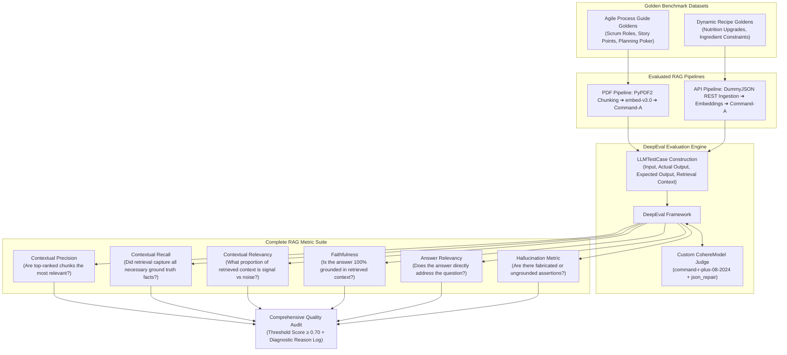

# RAG Evaluation Suite

[](https://www.python.org/downloads/)
[](https://confident-ai.com/)
[](https://cohere.com/)
[](https://scikit-learn.org/)
[](https://opensource.org/licenses/MIT)

A comprehensive, production-grade **Retrieval-Augmented Generation (RAG) Evaluation Benchmark Suite** built with **DeepEval**, **Pytest**, and a custom **Cohere LLM-as-a-Judge**.

This repository showcases how to evaluate both document-based (PDF) and live API-driven (REST JSON) RAG systems across the **RAG Triad** and advanced contextual retrieval benchmarks using curated **Golden Datasets**.

---

## Evaluation Architecture



---

## Evaluated Metrics Deep Dive

| Metric | Target Layer | What It Measures | Threshold |
|---|---|---|---|
| **Contextual Precision** | Retriever | Verifies that relevant context nodes are ranked higher than irrelevant nodes in top-K results. | `0.70` |
| **Contextual Recall** | Retriever | Measures whether the retrieved context contains all factual statements present in the Golden reference answer. | `0.70` |
| **Contextual Relevancy** | Retriever | Calculates the proportion of relevant sentences in the retrieved context versus total sentences (noise penalty). | `0.70` |
| **Faithfulness** | Generator | Verifies whether every statement in the generated answer can be strictly inferred from the retrieval context. | `0.70` |
| **Answer Relevancy** | Generator | Measures how directly and concisely the answer responds to the user's initial question without drifting off-topic. | `0.70` |
| **Hallucination Metric** | Generator | Detects hallucinated facts by cross-referencing generated statements against the context. | `0.70` |

---

## Project Structure

```text
LLM-rag-evaluation-suite/
├── .env.example                               # Environment configuration template
├── .gitignore                                 # Git ignore patterns
├── LICENSE                                    # MIT License
├── README.md                                  # Repository documentation
├── requirements.txt                           # Production dependencies
├── data/                                      # Sample reference documents
│   └── Agile_Process_Guide_5_Pages.pdf        # PDF guide for retrieval benchmarking
├── src/
│   ├── __init__.py
│   └── cohere_evalmodel.py                    # Custom DeepEvalBaseLLM implementation
└── tests/
    ├── test_01_pdf_rag_contextual_metrics.py  # 5-metric contextual evaluation on PDF pipeline
    └── test_02_api_rag_golden_benchmark.py   # Live REST API RAG evaluation on recipe catalog
```

---

## Getting Started

### 1. Prerequisites
- Python 3.10+
- A Cohere API key ([Cohere Dashboard](https://dashboard.cohere.com/api-keys))

### 2. Installation

```bash
# Clone the repository
git clone https://github.com/<your-username>/LLM-rag-evaluation-suite.git
cd LLM-rag-evaluation-suite

# Create and activate virtual environment
python -m venv .venv

# Windows:
.venv\Scripts\activate
# Linux/macOS:
source .venv/bin/activate

# Install dependencies
pip install -r requirements.txt
```

### 3. Environment Configuration

```bash
cp .env.example .env
```

Add your Cohere API key to `.env`:
```env
COHERE_API_KEY=your_actual_cohere_api_key_here
```

---

## Running the Benchmark Tests

### Option A: Using Pytest
```bash
pytest tests/ -v -s
```

### Option B: Using DeepEval CLI (with detailed telemetry tables)
```bash
deepeval test run tests/test_01_pdf_rag_contextual_metrics.py
```

### Option C: Direct Python Execution
```bash
# 1. Evaluate PDF RAG pipeline with 5 contextual metrics
python tests/test_01_pdf_rag_contextual_metrics.py

# 2. Evaluate Live REST API RAG pipeline with Golden benchmarks
python tests/test_02_api_rag_golden_benchmark.py
```

---

## Sample Benchmark Output

```text
========================================================================================
Evaluating PDF RAG Pipeline across 5 Contextual Metrics...
========================================================================================

Test Case: "Tell the exact role and responsibilities of Scrum Master..."
  • Faithfulness Metric:         Score: 1.00  | Success: True
  • Answer Relevancy Metric:     Score: 0.95  | Success: True
  • Contextual Precision Metric: Score: 1.00  | Success: True
  • Contextual Recall Metric:    Score: 1.00  | Success: True
  • Contextual Relevancy Metric: Score: 0.88  | Success: True

Reason:
- The generated answer is directly derived from the Scrum Master responsibilities section in Chunk 1.
- All golden statements (facilitation, removing impediments, process adherence) were recalled.
- Retrieved context contained minimal noise.

PASSED [All 5 Metrics Satisfied]
```

---

## License
Distributed under the [MIT License](LICENSE).
